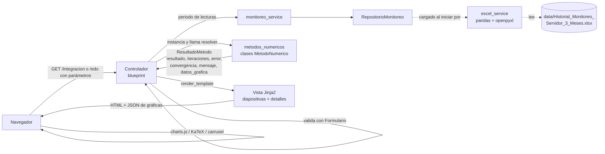
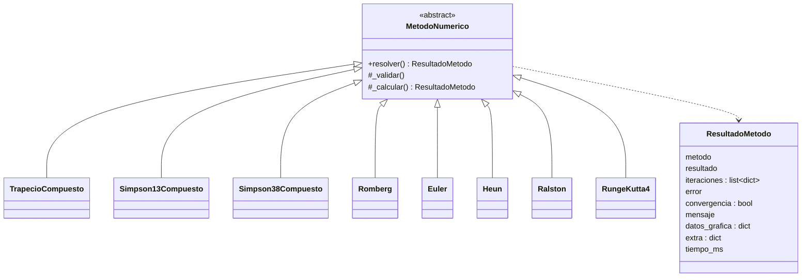

# Arquitectura

La aplicación sigue el patrón **MVC** con una capa de servicios y un paquete independiente con los
algoritmos numéricos.

| Capa | Carpeta | Responsabilidad |
|------|---------|-----------------|
| Modelo | `app/models/` | `LecturaServidor` (una fila de *Historial*) y `RepositorioMonitoreo` (consultas en memoria: filtros, ordenamiento, rangos de horas, vectores NumPy). |
| Servicios | `app/services/` | `excel_service` lee y valida el Excel (único lugar con pandas/openpyxl); `monitoreo_service` prepara los datos de cada módulo (resumen del dashboard, paginación, periodos de 24 h). |
| Métodos numéricos | `app/metodos_numericos/` | **Todas** las fórmulas. Clases que heredan de `MetodoNumerico` y exponen `resolver()` → `ResultadoMetodo`. |
| Controlador | `app/controllers/` | Un *blueprint* por módulo. Valida la solicitud (`comun.Formulario`), pide datos al servicio, instancia las clases de `metodos_numericos`, llama a `resolver()` y entrega el resultado a la vista. No contiene fórmulas. |
| Vista | `app/templates/`, `app/static/` | Jinja2 + Bootstrap 5. KaTeX para fórmulas, Chart.js para gráficas y un carrusel de Bootstrap para las diapositivas. JavaScript **no** recalcula nada: solo navega y dibuja series que ya vienen del backend. |

## Flujo de una solicitud

Vista → controlador → servicio → `metodos_numericos` → `ResultadoMetodo` → vista.

## Estructura común de los métodos

`resolver()` es un *template method*: llama a `_validar()` (lanza `ErrorValidacion` con mensajes para
estudiantes), mide el tiempo y ejecuta `_calcular()`. El controlador envuelve la llamada con
`comun.ejecutar_seguro()`, que convierte un `ErrorValidacion` en un `ResultadoMetodo` fallido para que
un método no aplicable (p. ej. Simpson 3/8 con n = 10) no detenga los demás.

Funciones puras reutilizables: `validar_finito`, `validar_positivo`, `tabla_comparativa`,
`resultado_fallido` (`base.py`); `paso_uniforme`, `niveles_romberg` (`integracion.py`);
`alfa_estado_estacionario` (`edo.py`); `interpolacion_lineal` (`interpolacion.py`);
`errores_serie` (`errores.py`).

## Qué controlador llama a qué

| Controlador (ruta) | Servicio | Clases / funciones de `metodos_numericos` |
|---|---|---|
| `dashboard_controller` (`/`) | `monitoreo_service.resumen_dashboard` | `TrapecioCompuesto` (energía total, llamado desde el servicio) |
| `datos_controller` (`/datos/`, `/datos/descargar`) | `monitoreo_service.historial_paginado` | — (solo datos) |
| `integracion_controller` (`/integracion/`) | `periodo`, `fechas_disponibles` | `TrapecioCompuesto`, `Simpson13Compuesto`, `Simpson38Compuesto`, `Romberg` (usa `niveles_romberg` y `TrapecioCompuesto`), `tabla_comparativa` |
| `edo_controller` (`/edo/`) | `periodo`, `fechas_disponibles` | `ModeloTermicoEDO` (usa `interpolacion_lineal`), `alfa_estado_estacionario`, `Euler`, `Heun`, `Ralston`, `RungeKutta4`, `errores_serie`, `tabla_comparativa` |

## Vistas de presentación

`templates/_presentacion.html` define los componentes del modo presentación:

| Macro | Uso |
|---|---|
| `presentacion(id, tema, color)` | Contenedor con barra superior, contador, barra de progreso, carrusel y pie con Anterior/Siguiente y puntos. |
| `portada(...)` | Primera diapositiva: título, resumen, nombre del expositor editable y cifras clave. |
| `diapositiva(titulo, seccion)` | Diapositiva genérica. |
| `cifra(etiqueta, valor, unidad, destacada)` | Tarjeta con un valor calculado. |
| `separador_detalles()` | Divide la presentación de los detalles paso a paso. |

`static/js/modules.js` crea los puntos de navegación, el contador, el teclado (← → Re Pág Av Pág Inicio
Fin F), la pantalla completa, el anclaje `#diapositiva-N` y guarda el nombre del expositor en
`localStorage`. `static/js/charts.js` dibuja cada gráfica cuando su diapositiva se hace visible.

## Manejo de errores y seguridad

- **Datos**: `create_app()` intenta cargar el Excel. Si falla (`ErrorDatosExcel`), guarda el mensaje y
  un `before_request` muestra `error.html` (HTTP 503) en todas las rutas.
- **Entradas**: `comun.Formulario` convierte y acota cada parámetro (tipo, mínimo, máximo, opciones
  permitidas, longitud de texto). Jinja2 escapa automáticamente toda salida HTML; los datos de gráficas
  se serializan con `tojson`.
- **Errores técnicos**: el manejador global registra la traza en `logs/app.log` y muestra un mensaje
  genérico; nunca se exponen trazas al usuario.
- **Precisión**: los cálculos conservan precisión `float` completa; el filtro Jinja `f5` redondea a
  cinco decimales solo al mostrar.
